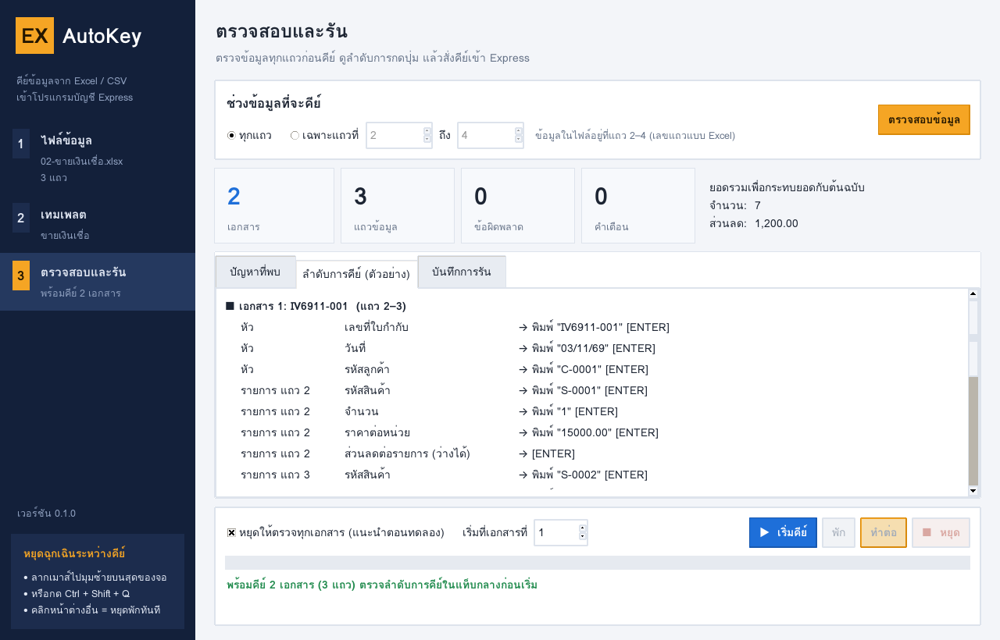
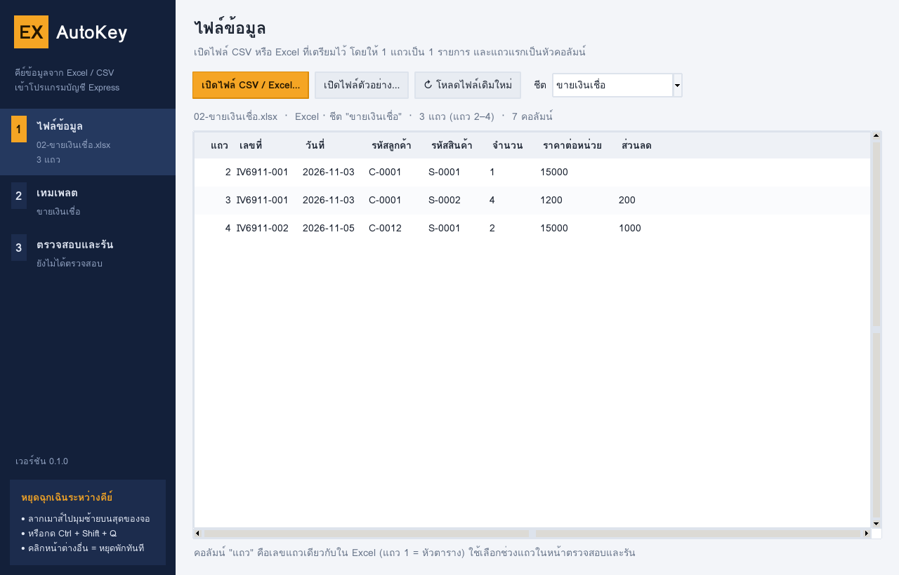
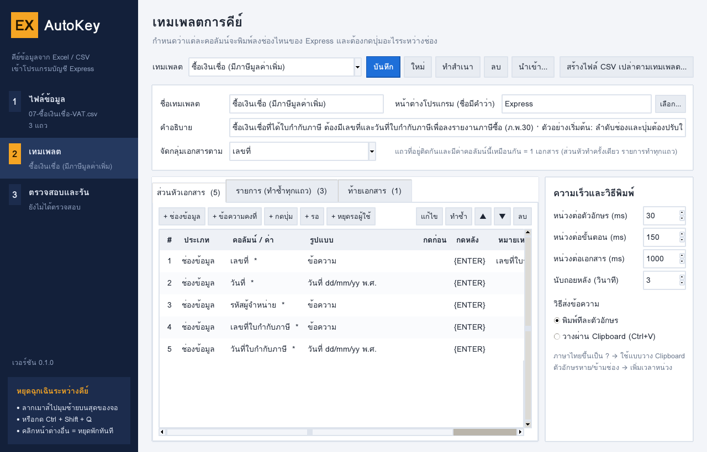
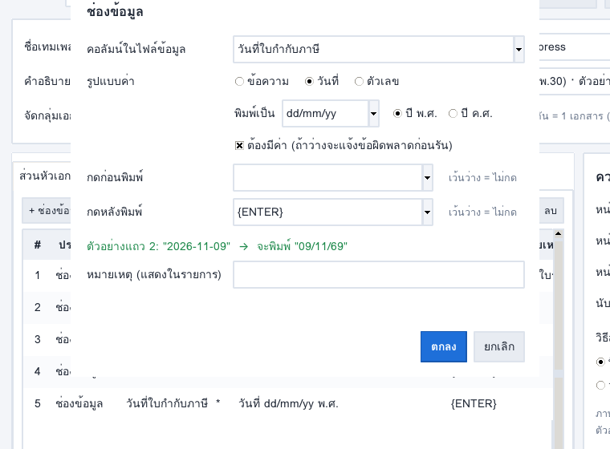

# EX-AutoKey

โปรแกรมคีย์ข้อมูลจากไฟล์ **Excel / CSV** เข้าโปรแกรมบัญชี **Express** อัตโนมัติ บน Windows
แทนการพิมพ์ทีละเอกสาร: เตรียมข้อมูลใน Excel → เลือกเทมเพลต → ตรวจสอบ → สั่งคีย์



> ⚠️ ก่อนคีย์จริงทุกครั้ง **สำรองข้อมูล Express** และทดลองกับบริษัททดสอบ (หรือสำเนาฐานข้อมูล) ก่อน
> เทมเพลตตัวอย่างเป็นเพียงโครงเริ่มต้น ลำดับช่องและปุ่มต้องปรับให้ตรงกับหน้าจอ Express ของคุณ

---

## ทำงานอย่างไร

| ขั้นตอน | ในโปรแกรม | สิ่งที่ทำ |
|---|---|---|
| 1 | **ไฟล์ข้อมูล** | เปิดไฟล์ `.xlsx` หรือ `.csv` (UTF-8 หรือภาษาไทย ANSI ก็ได้) แสดงข้อมูลพร้อมเลขแถวแบบเดียวกับ Excel |
| 2 | **เทมเพลต** | กำหนดลำดับการคีย์ 1 เอกสาร: คอลัมน์ไหนพิมพ์ลงช่องไหน ต้องกด Enter/Tab/F-key อะไรระหว่างช่อง |
| 3 | **ตรวจสอบและรัน** | ตรวจข้อมูลทุกแถวก่อนคีย์ ดูลำดับการกดปุ่ม ยอดรวมเพื่อกระทบยอด เลือกช่วงแถว แล้วสั่งคีย์ |

| ไฟล์ข้อมูล | เทมเพลต | แก้ไขขั้นตอน |
|---|---|---|
|  |  |  |

## ติดตั้ง

**แบบไฟล์ .exe (ไม่ต้องติดตั้ง Python)**
1. เปิดแท็บ **Actions** ของ repository นี้ → เลือก run ล่าสุดของ workflow *test-and-build* ที่สำเร็จ
2. ดาวน์โหลด artifact **EX-AutoKey-windows** แล้วแตกไฟล์ไว้ในโฟลเดอร์ที่เขียนไฟล์ได้ เช่น `D:\EX-AutoKey`
3. ดับเบิลคลิก `EX-AutoKey.exe`

หรือ build เองบนเครื่อง Windows ที่มี Python 3.10+ ด้วย `build_windows.bat`

**แบบรันจากซอร์ส (มี Python 3.10+ บน Windows)**
```bat
pip install -r requirements.txt
pythonw EX-AutoKey.pyw
```

โปรแกรมจะเก็บเทมเพลตไว้ในโฟลเดอร์ `templates\` และผลการรันไว้ในโฟลเดอร์ `logs\` ข้างไฟล์โปรแกรม
(ถ้าโฟลเดอร์นั้นเขียนไม่ได้ จะใช้ `%APPDATA%\EX-AutoKey` แทน)

## 1. เตรียมไฟล์ข้อมูล

- แถวแรกเป็น **หัวคอลัมน์** ชื่อหัวคอลัมน์ต้องตรงกับที่เทมเพลตใช้ (กด *สร้างไฟล์ CSV เปล่าตามเทมเพลต…* เพื่อได้หัวคอลัมน์ที่ถูกต้อง)
- **1 แถว = 1 รายการ** ถ้าเอกสารมีหลายรายการ ให้ใส่เลขที่เอกสารซ้ำทุกแถว และให้แถวของเอกสารเดียวกัน **อยู่ติดกัน**
- ข้อมูลส่วนหัว (วันที่ รหัสลูกค้า ฯลฯ) ของเอกสารเดียวกันต้องเหมือนกันทุกแถว ถ้าไม่ตรงกันโปรแกรมจะแจ้งข้อผิดพลาด
- วันที่ใส่ได้หลายแบบ: `22/11/2569`, `22/11/2026`, `22/11/69`, `2026-11-22`, `22 พ.ย. 69` หรือเซลล์วันที่ของ Excel
  (ปี 2 หลัก 40–99 ถือเป็น พ.ศ. 25xx, 00–39 ถือเป็น ค.ศ. 20xx)
- ตัวเลขใส่คอมมาได้ `1,500.00` ติดลบใช้ `-500` หรือ `(500)` ได้

ตัวอย่างไฟล์อยู่ในโฟลเดอร์ [`samples/`](samples) คู่กับเทมเพลตแต่ละแบบ

## 2. เทมเพลต

เทมเพลต 1 ไฟล์ = วิธีคีย์ 1 หน้าจอของ Express แบ่งเป็น 3 ส่วน

| ส่วน | ทำเมื่อไร |
|---|---|
| ส่วนหัวเอกสาร | 1 ครั้งต่อเอกสาร (ใช้ค่าจากแถวแรกของเอกสาร) |
| รายการ | ทำซ้ำทุกแถวของเอกสาร |
| ท้ายเอกสาร | 1 ครั้งต่อเอกสาร เช่น กดบันทึก |

**จัดกลุ่มเอกสารตาม**: เลือกคอลัมน์เลขที่เอกสาร แถวที่อยู่ติดกันและมีเลขที่เดียวกัน = 1 เอกสาร
(ถ้าไม่เลือก 1 แถว = 1 เอกสาร)

ประเภทขั้นตอน

| ประเภท | ใช้ทำอะไร |
|---|---|
| ช่องข้อมูล | พิมพ์ค่าจากคอลัมน์ (แปลงรูปแบบวันที่ / ตัวเลขให้อัตโนมัติ) แล้วกดปุ่มที่กำหนด |
| ข้อความคงที่ | พิมพ์ข้อความเดิมทุกเอกสาร |
| กดปุ่ม | กดปุ่มหรือชุดปุ่ม เช่น `{F9}` `^s` `{TAB 3}` |
| รอ | รอให้ Express โหลดหน้าจอ |
| หยุดรอผู้ใช้ | หยุดให้ผู้ใช้ตรวจหรือทำเองใน Express แล้วกด *ทำต่อ* |

รูปแบบค่าของช่องข้อมูล
- **วันที่**: เลือกรูปแบบที่ Express รับ เช่น `dd/mm/yy` หรือ `ddmmyy` และเลือกปี พ.ศ./ค.ศ.
- **ตัวเลข**: กำหนดทศนิยม (ปัดเศษแบบครึ่งขึ้น) ใส่คอมมาหรือไม่ และเลือก *แสดงยอดรวม* เพื่อใช้กระทบยอด
- **ข้อความ**: กำหนดความยาวสูงสุดได้ กันข้อความยาวเกินช่องแล้วล้นไปช่องถัดไป

วิธีเขียนปุ่ม (แบบเดียวกับ SendKeys)

| เขียน | ความหมาย |
|---|---|
| `{ENTER}` `{TAB}` `{ESC}` `{F1}`…`{F12}` | ปุ่มพิเศษ |
| `{UP}` `{DOWN}` `{LEFT}` `{RIGHT}` `{HOME}` `{END}` `{PGUP}` `{PGDN}` `{DEL}` `{BS}` `{INS}` `{SPACE}` | ปุ่มลูกศรและปุ่มแก้ไข |
| `{TAB 3}` | กด TAB 3 ครั้ง |
| `{WAIT 500}` | รอ 0.5 วินาที |
| `^s` `%{F4}` `+{TAB}` | `^` = Ctrl, `%` = Alt, `+` = Shift |
| `{+}` `{^}` `{%}` `{{}` `{}}` | พิมพ์อักขระนั้นตรง ๆ |

### ปรับเทมเพลตให้ตรงกับ Express ของคุณ (ทำครั้งแรกครั้งเดียว)

1. เปิดหน้าจอบันทึกใน Express แล้วลองคีย์ด้วยมือ 1 เอกสาร จดลำดับช่องและปุ่มที่กด (Enter หรือ Tab, ปุ่มบันทึก, ปุ่มขึ้นบรรทัดรายการใหม่)
2. แก้เทมเพลตให้ลำดับตรงกัน เทมเพลตตัวอย่างจบด้วยขั้นตอน *หยุดรอผู้ใช้* ให้กดบันทึกเอง เมื่อทดสอบผ่านแล้วค่อยเปลี่ยนเป็นขั้นตอน *กดปุ่ม* ที่เป็นปุ่มบันทึกจริง
3. ช่องที่ Express ใส่ค่าให้อัตโนมัติ (เช่น เลขที่เอกสาร) ถ้าไม่ต้องการพิมพ์ทับ ให้ลบขั้นตอนนั้นแล้วใส่ *กดปุ่ม* `{ENTER}` แทน
4. ทดลองรันทีละ 1–2 เอกสาร โดยเปิด *หยุดให้ตรวจทุกเอกสาร* ไว้
5. ถ้าตัวอักษรหายหรือข้ามช่อง ให้เพิ่มเวลาหน่วง ถ้าภาษาไทยขึ้นเป็น `?` ให้เปลี่ยนวิธีส่งข้อความเป็น *วางผ่าน Clipboard*

## 3. ตรวจสอบและรัน

- **ตรวจสอบข้อมูล** ตรวจทุกแถวก่อนเริ่ม: วันที่ไม่มีจริง ตัวเลขผิด ช่องบังคับว่าง คอลัมน์หาย ข้อมูลส่วนหัวไม่ตรงกัน
  แถวของเอกสารไม่ติดกัน หรือช่วงแถวที่เลือกตัดเอกสารไม่ครบ ถ้ายังมีข้อผิดพลาดจะสั่งคีย์ไม่ได้
  ดับเบิลคลิกรายการปัญหาเพื่อไปดูแถวนั้นในข้อมูล
- **ยอดรวมเพื่อกระทบยอด** ใช้เทียบกับยอดในไฟล์ต้นฉบับก่อนคีย์ และเทียบกับรายงานใน Express หลังคีย์
- **ลำดับการคีย์** แสดงทุกปุ่มที่จะกดของแต่ละเอกสาร
- เลือก **เฉพาะแถวที่…ถึง…** (เลขแถวแบบ Excel) เพื่อคีย์บางส่วน และ **เริ่มที่เอกสารที่** เพื่อคีย์ต่อจากที่ค้าง
- ทุกครั้งที่รัน โปรแกรมบันทึกผลเป็นไฟล์ CSV ใน `logs\` ว่าเอกสารไหนคีย์ครบ เอกสารไหนหยุดกลางทาง

### ความปลอดภัยระหว่างคีย์

- **หยุดฉุกเฉิน**: ลากเมาส์ไปมุมซ้ายบนสุดของจอ หรือกด `Ctrl + Shift + Q`
- **คลิกหน้าต่างอื่น = หยุดพักทันที** โปรแกรมจะพิมพ์เฉพาะเมื่อหน้าต่างของ Express อยู่ด้านหน้าเท่านั้น กด *ทำต่อ* เพื่อกลับไปคีย์ต่อ
- ถ้าหยุดกลางเอกสาร โปรแกรมจะแจ้งเลขที่เอกสารที่คีย์ไม่ครบ ให้ตรวจและแก้หรือยกเลิกใน Express เอง

## เทมเพลตตัวอย่าง

| ไฟล์ | ใช้กับ |
|---|---|
| `01-ขายเงินสด` | ขายเงินสด หลายรายการต่อเอกสาร |
| `02-ขายเงินเชื่อ` | ขายเงินเชื่อ (มีไฟล์ตัวอย่างแบบ .xlsx ด้วย) |
| `03-ขายเงินเชื่อ-ตัดสต๊อก` | ขายเงินเชื่อที่ระบุคลังสินค้า |
| `04-รับชำระหนี้` | รับชำระหนี้ 1 ใบเสร็จหลายใบกำกับ |
| `05-ซื้อเงินสด` | ซื้อเงินสด |
| `06-ซื้อเงินเชื่อ` | ซื้อเงินเชื่อ |
| `07-ซื้อเงินเชื่อ-VAT` | ซื้อเงินเชื่อมีใบกำกับภาษี (เลขที่และวันที่ใบกำกับสำหรับรายงานภาษีซื้อ ภ.พ.30) |
| `08-ซื้อเงินเชื่อ-รับเข้าสต๊อก` | ซื้อเงินเชื่อที่ระบุคลังที่รับเข้า |
| `09-จ่ายชำระหนี้` | จ่ายชำระหนี้ 1 ใบสำคัญจ่ายหลายใบรับสินค้า |
| `10-จ่ายค่าใช้จ่าย-หัก-ณ-ที่จ่าย` | ค่าใช้จ่ายและอัตราภาษีหัก ณ ที่จ่าย (เช่น ค่าบริการ 3%, ค่าเช่า 5%, ค่าโฆษณา 2%, ค่าขนส่ง 1%) |

## ปัญหาที่พบบ่อย

| อาการ | วิธีแก้ |
|---|---|
| ไม่พบหน้าต่าง Express | เปิด Express ก่อน และตรวจช่อง *หน้าต่างโปรแกรม* ในเทมเพลต กด *เลือก…* เพื่อเลือกจากหน้าต่างที่เปิดอยู่ |
| พบหลายโปรแกรมที่ชื่อตรงกัน | ใส่ชื่อหน้าต่างให้เจาะจงขึ้น หรือปิดโปรแกรมอื่นที่มีคำว่า Express |
| ภาษาไทยขึ้นเป็น `?` | ติดตั้งแป้นพิมพ์ภาษาไทยใน Windows หรือเปลี่ยนวิธีส่งข้อความเป็น *วางผ่าน Clipboard* |
| ตัวอักษรหาย / พิมพ์ข้ามช่อง | เพิ่ม *หน่วงต่อตัวอักษร* และ *หน่วงต่อขั้นตอน* หรือใส่ขั้นตอน *รอ* หลังช่องที่ Express ต้องค้นหาข้อมูล |
| ส่งปุ่มไม่สำเร็จ | ถ้า Express เปิดแบบ *Run as administrator* ต้องเปิด EX-AutoKey แบบ administrator ด้วย |
| เปิดไฟล์ Excel ไม่ได้ | ปิดไฟล์ใน Excel ก่อน ไฟล์ `.xls` รุ่นเก่าให้บันทึกเป็น `.xlsx` หรือ CSV |

## สำหรับนักพัฒนา

```
exautokey/
  keyspec.py     แปลงข้อความปุ่ม {ENTER} ^s ฯลฯ
  formats.py     แปลงวันที่ (พ.ศ./ค.ศ.) และตัวเลข (Decimal ปัดครึ่งขึ้น)
  data.py        อ่าน CSV (UTF-8 / cp874) และ .xlsx
  template.py    โครงสร้างเทมเพลต (JSON)
  engine.py      สร้างแผนการคีย์ ตรวจสอบข้อมูล และ Runner (พัก/ทำต่อ/หยุด)
  backends.py    อินเทอร์เฟซตัวส่งปุ่ม + ตัวจำลองสำหรับทดสอบ
  winbackend.py  ส่งปุ่มจริงด้วย Win32 SendInput (ctypes)
  gui/           หน้าจอ tkinter
templates/       เทมเพลตตัวอย่าง
samples/         ไฟล์ข้อมูลตัวอย่างคู่กับเทมเพลต
tests/           pytest
```

```bash
pip install -r requirements.txt pytest
pytest -q
```

ส่วนที่ส่งปุ่มจริง (`winbackend.py`) ทำงานเฉพาะบน Windows และยังไม่ได้ทดสอบกับโปรแกรม Express ตัวจริง
GitHub Actions รันชุดทดสอบทั้งบน Linux และ Windows แล้ว build ไฟล์ `.exe`
